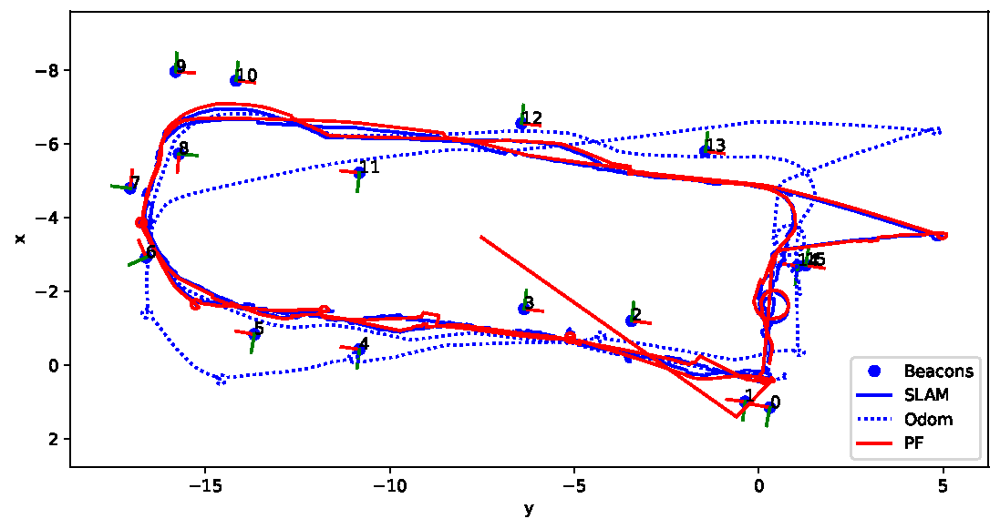
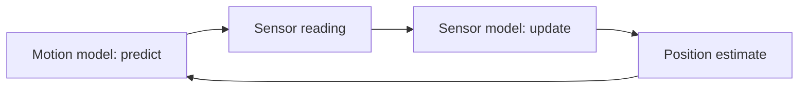

## Overview

This project implements three core mobile robotics techniques in Python, each built from real sensor data:
- Part A: an extended Kalman filter (EKF) tracking a drone's position and speed from two range beacons
- Part B: a particle filter localising a TurtleBot using odometry and fiducial marker beacons
- Part C: an occupancy grid map of a lab and corridor built from lidar scans

## Table of Contents

- [Overview](#overview)
- [Table of Contents](#table-of-contents)
- [Filter Structure](#filter-structure)
- [Part A: Extended Kalman Filter](#part-a-extended-kalman-filter)
- [Part B: Particle Filter](#part-b-particle-filter)
- [Part C: Occupancy Grid](#part-c-occupancy-grid)

## Filter Structure
Both filters follow the same predict and update loop.

## Part A: Extended Kalman Filter
The range sensors were calibrated against lidar ground truth to build the sensor model and its noise. A motion model was found from training data. The EKF estimate was compared against sensor-only and dead-reckoning estimates, then applied to a set of cheaper sensors with outliers. Code is in `partA/`.

## Part B: Particle Filter
The particle filter moves each particle using the odometry, with added noise, then weights the particles by how well they match the observed beacons. Code is in `partB/`.

## Part C: Occupancy Grid
The lidar was first calibrated, removing readings outside the sensor's range before fitting. Each lidar beam then marks its end cell as occupied and every cell along the beam as free, using Bresenham's line algorithm. Code is in `partC/`.
